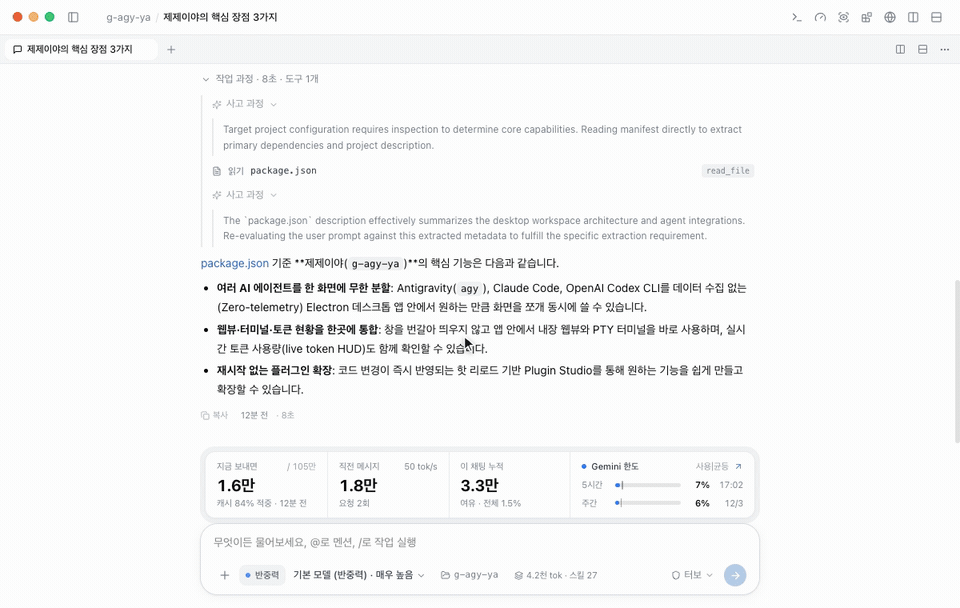
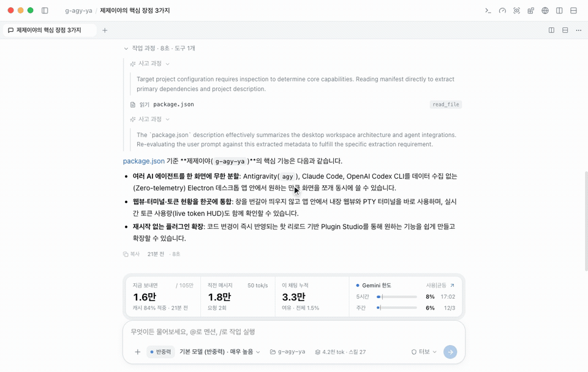
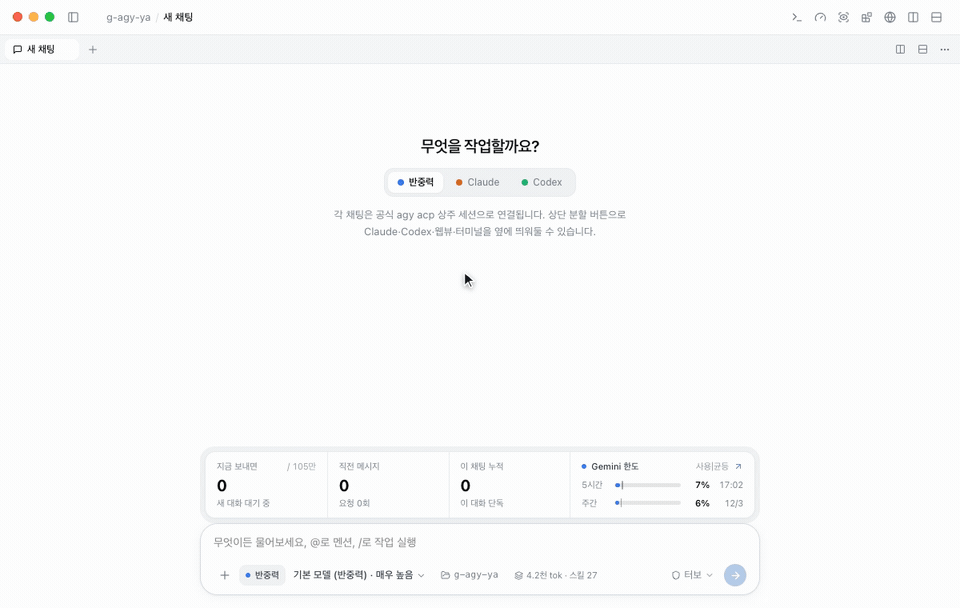
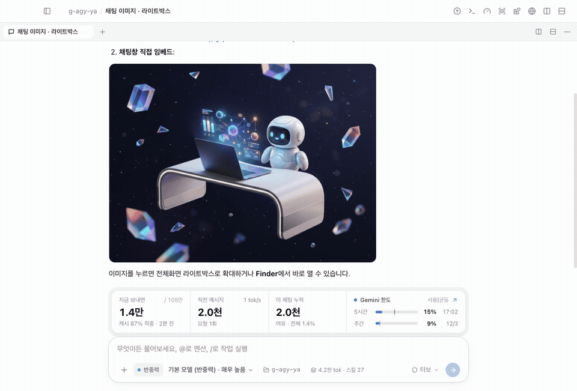

<div align="center">


# g-agy-ya (제제이야)

**Built out of pure frustration because vanilla Antigravity (`agy`) wouldn't even let me add a simple Token Band.**

[한국어](README.md) · [English](README.en.md)

[](LICENSE)
[](#faq)

</div>

---

## Why I Built This

I just wanted to add a small **Token Band** to vanilla Antigravity so I could see how many tokens I was burning and how much quota I had left.  
Vanilla wouldn't even let me build that.

So I built my own desktop app from scratch. Since I was building it anyway, I made **everything a plugin you can swap or build yourself**, put **Antigravity, Claude Code, and OpenAI Codex in one app**, and added **infinite split panes** so you never have to juggle windows again.

<p align="center">
  
</p>

- See **current context size, cache hit rate, generation speed (`tok/s`), and 5-hour/weekly limits** right above your chat box.
- Click to expand **per-tool token spikes** and **recent turn history**.
- Open the **Unified Token Band (`⌘⇧U`)** to compare Antigravity, Claude Code, and Codex quotas side by side.

---

## Core Features

### 1. Plugin-First Philosophy — Everything Is a Plugin

Because this whole project started from not being able to add a single bar, **every feature in the app is an independent plugin**—chat, Token Band, built-in browser, terminal, and Git Diff.

<p align="center">
  
</p>

- **UI X-Ray (`⌘⇧X`)**: Inspect which plugin owns any part of the screen at a glance.
- **Full-Window Plugin Studio (`⌘⇧P`)**: Turn features on or off live without restarting the app (watch the Token Band vanish and pop back in real time above).
- **Bundled Default Skills & Plugins (`Korean Pack` · `Token Band`)**: On first launch, [`bundled-plugins/korean-pack`](bundled-plugins/korean-pack) (Korean response policy) and [`bundled-plugins/token-band`](bundled-plugins/token-band) (Token Band skill, HUD hook & zero-dependency MCP server) are automatically seeded into `~/.gemini/config/plugins/`. Toggle them anytime in Plugin Studio or reinstall with `npm run install:plugins`.
- **Build & Mount Your Own**: Point to a local plugin folder and see your edits hot-reload immediately without rebuilding the app ([see sample plugin](examples/sample-focus-timer)).

---

### 2. Multiple Models in One App — Antigravity · Claude · Codex

Stop bouncing between apps and terminal tabs every time you want a different model.  
**g-agy-ya** plugs directly into the official CLIs already installed on your machine (`agy`, `claude`, `codex`).

<p align="center">
  
</p>

- Switch between **Antigravity, Claude Code, and OpenAI Codex** in one click.
- Pick from **27+ models and reasoning effort levels** without leaving the chat.
- Put **all three agents side by side in one window** to compare answers or run tasks in parallel.
- No extra API keys or middleman servers—keeps your existing official CLI logins, local skills, rules, and MCP servers intact.

---

### 3. Infinite Split Workspace — Chat, Browser & Terminal Together

No more `⌘Tab` ping-pong between your AI chat, browser preview, and terminal.

<p align="center">
  
</p>

- **Split endlessly** horizontally (`⌘D`) or vertically (`⌘⇧D`).
- **Drag any tab to any edge** to dock and rearrange panes on the fly.
- **Built-in Browser (`⌘T`) & Terminal (`⌘⇧T`)**: Keep `localhost`, docs, GitHub, and a live shell right next to your agent.

---

### 4. Inline Chat Images, Lightbox & One-Click Updates

No need to jump out to Finder every time your agent generates an image, or open a terminal to `git pull` every time a new patch lands.

<p align="center">
  
</p>

- **Inline Chat Images**: Renders local (`/abs/path`, `~/...`, `file://`, workspace-relative) and remote raster images directly inside assistant bubbles via an image-only Electron protocol (non-image files, SVGs, and XSS payloads stay strictly blocked).
- **Fullscreen Lightbox & Local File Links**: Click any inline image or image link to zoom in with **Reveal in Finder** and `Esc` to close; click non-image `file://` links (like Markdown artifacts) to open them in your default app.
- **History & ACP Image Restoration**: Reopening past transcripts restores user-uploaded media and direct ACP image chunks seamlessly.
- **One-Click In-App Updates (`app-updater`)**: Quietly checks GitHub for new patches, surfaces an **Update** badge in the top bar, and handles `git pull`, rebuild, and app relaunch in one click.

---

## What's New (`v0.1.1+`)

- **Inline Chat Image Viewer & Lightbox** — local/remote markdown image rendering, fullscreen lightbox with Finder reveal, clickable `file://` links, and transcript/ACP image restoration
- **One-Click In-App Updater (`app-updater`)** — automatic GitHub patch detection and one-click pull/build/relaunch
- **Bundled Default Plugins (`Korean Pack` · `Token Band`)** — auto-seeded on first run (`npm run install:plugins` to reinstall anytime)
- **Unified `제제이야` App Branding** — window title, OS notifications, tray tooltip, and macOS bundle metadata

---

## Quick Start

### Prerequisites

- **Node.js 22+**
- **At least one** of the official CLIs below (you don't need all three):
  - **Antigravity (`agy`)**: Sign in via `agy` or one-click login inside the app
  - **Claude Code (`claude`)**: `npm install -g @anthropic-ai/claude-code`
  - **OpenAI Codex (`codex`)**: `npm install -g @openai/codex`

### Run in 3 Lines

```bash
git clone https://github.com/moneycode11101-svg/g-agy-ya.git
cd g-agy-ya
npm install && npm start
```

> Use `npm run dev` if you want live hot-reload while hacking on the app.

---

## Handy Shortcuts

| Shortcut | Action |
| :--- | :--- |
| `⌘N` | Open new chat |
| `⌘D` / `⌘⇧D` | Split right / split down |
| `⌘T` | Open built-in browser split |
| `⌘⇧T` | Open terminal split |
| `⌘⇧U` | Open Unified Token Band dashboard |
| `⌘⇧P` | Open Plugin Studio (full window) |
| `⌘⇧X` | Toggle UI X-Ray overlay |
| `⌘B` | Toggle sidebar |

---

## FAQ

- **How do updates work?**  
  The built-in `app-updater` plugin quietly checks GitHub on launch and shows an **Update** badge when new patches arrive. One click runs `git pull`, rebuilds, and restarts the app (or points to the latest release for packaged builds). You can toggle it off anytime in Plugin Studio.
- **Does anything leave my machine?**  
  No. **0% telemetry, 0 cloud relays.** It only talks to the official CLIs running locally on your computer.
- **What if my CLI login expires?**  
  Sign back in right inside the app with one click.
- **Does it work outside macOS?**  
  Built primarily for macOS, but runs on Windows/Linux via Electron as well (the built-in terminal pane requires `python3`).

---

## License

[MIT License](LICENSE)
