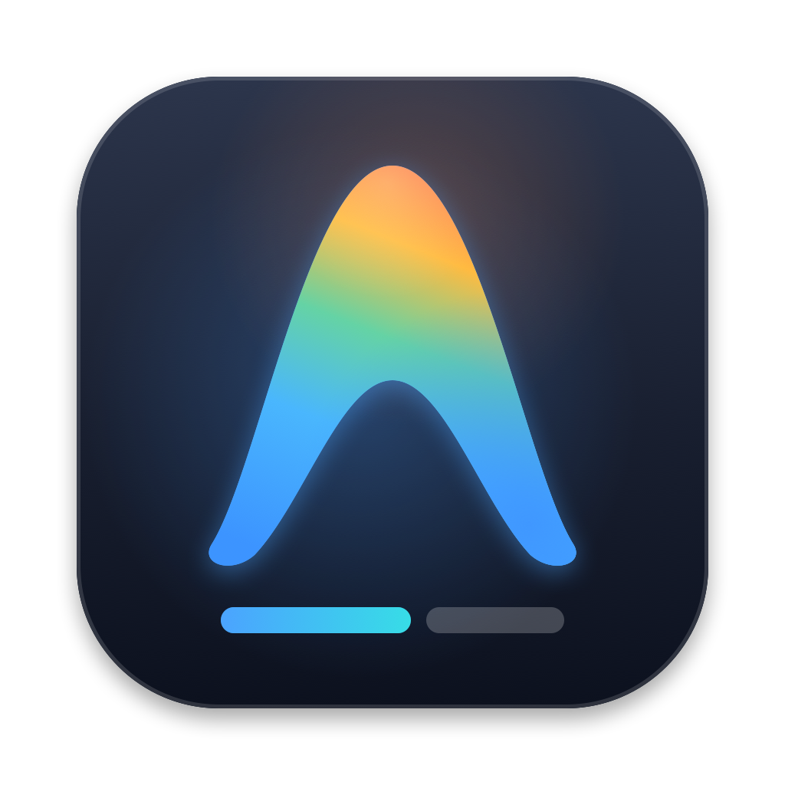
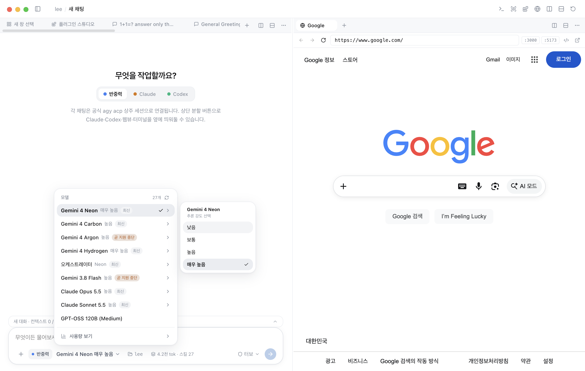
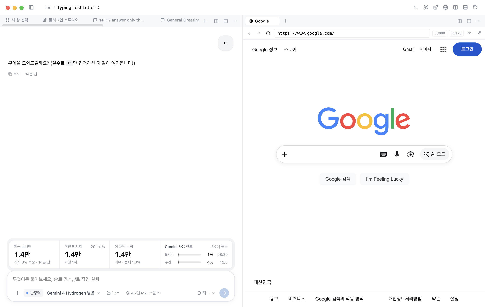
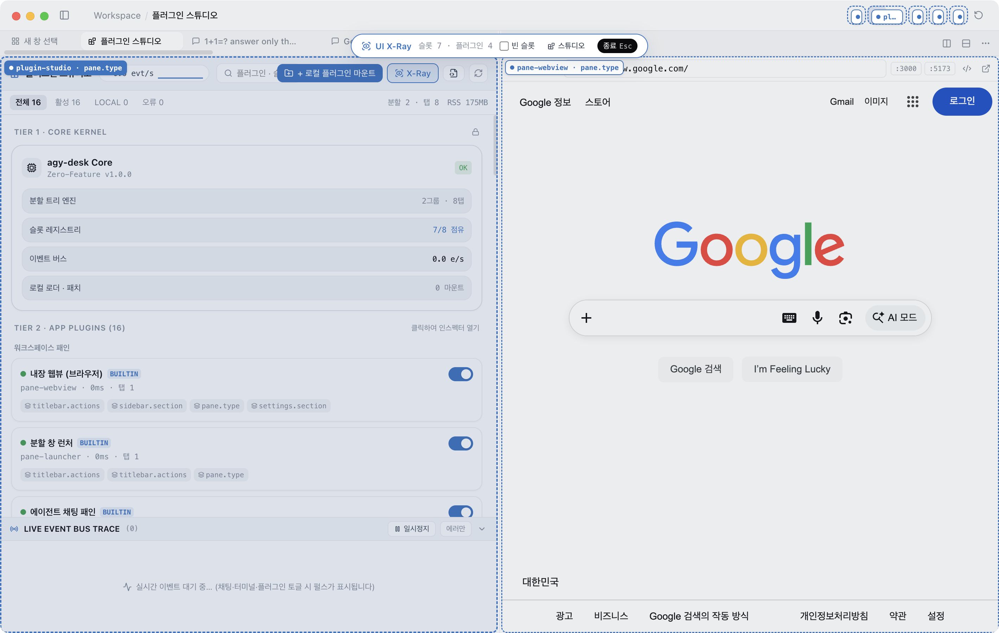
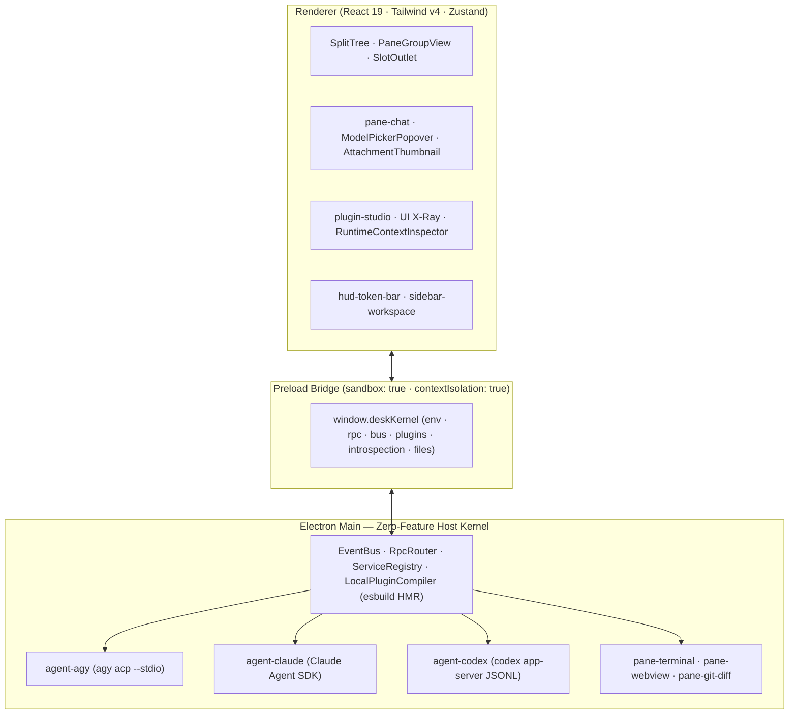

<div align="center">



# g-agy-ya (제제이야)

**Antigravity · Claude Code · OpenAI Codex in one infinite-split desktop workspace.**  
An ultra-lightweight, zero-telemetry Electron multi-agent workspace powered directly by your local official CLIs.

[한국어](README.md) · [English](README.en.md)

[](LICENSE)
[](https://www.electronjs.org/)
[](https://react.dev/)
[](https://www.typescriptlang.org/)
[](#privacy--local-first-design)

<br />



</div>

---

## Why g-agy-ya?

Stop juggling terminal tabs, browser windows, and separate AI apps. **g-agy-ya** connects directly to the official CLIs already installed on your machine (`agy`, `claude`, `codex`) inside a single infinite-split desktop workspace.

- **BYO CLI · 0% Telemetry**: No cloud relay, no analytics, no proprietary credential vault. It uses your existing official CLI sessions, local skills, rules, hooks, and MCP servers as-is.
- **One-Click In-App CLI Re-Login**: When a CLI session expires, sign back in right from the chat banner or settings (`agy acp` / `claude auth login` / `codex login`) and automatically resend your interrupted message.
- **Zero-Feature Micro-Kernel**: All **16 built-in features**—chat, terminal, embedded webview, Git Diff, token HUD, and every agent adapter—run as isolated plugins with live toggle and hot-reload support.

---

## Key Features

### 1. Three Native Persistent Multi-Agent Adapters

| Engine | Transport / Runtime | Highlights |
| :--- | :--- | :--- |
| **Antigravity (`agy`)** | Official `agy acp --stdio` daemon | 27+ models with cascading effort picker, multimodal image drag-and-drop, live thinking/tools/approval stream, queued follow-ups (send-now / edit / delete), one-click ACP loopback login |
| **Claude Code (`claude`)** | Official `@anthropic-ai/claude-agent-sdk` | Preserves local `CLAUDE.md`, hooks, skills & MCP, interactive tool approvals & `AskUserQuestion` cards, live 5h/weekly quota via SDK IPC, one-click `claude auth login` |
| **OpenAI Codex (`codex`)** | Official `codex app-server --stdio` JSONL | Live turn steering, interactive approvals & questions, multi-profile `CODEX_HOME` switching, live 5h/weekly rate limits, one-click `codex login` |

- **Image Drag-and-Drop & Thumbnail Strip**: Drag images from Finder, screenshots, or clipboard (`⌘V`) onto any chat pane to stack thumbnails above the composer, with full-size lightbox preview and folder (`--add-dir`) drop support.
- **Fast Composer Ergonomics**: Live `@` workspace file mentions, `/` slash commands & installed skills autocomplete, and clean Korean IME single-Enter submit.

### 2. Infinite Split Workspace & Live Token HUD



- **Recursive Split Tree & Drag-to-Dock**: Split horizontally (`⌘D`) or vertically (`⌘⇧D`) endlessly, drag tabs to any edge to dock, pin/color/rename tabs.
- **Embedded Chromium Webview (`⌘T`)**: Preview `localhost:3000` / `:5173` apps or documentation right alongside your agent, with one-click DevTools toggle.
- **Built-In PTY Terminal (`⌘⇧T`) & Git Diff**: Full `xterm.js` terminal and live Git diff viewer as first-class panes.
- **Zero-Overhead Token & Quota HUD**: Track context fill, cache hit rate, generation speed (`tok/s`), cumulative session tokens, and official 5-hour / weekly quotas without injecting a single token into your prompt.

### 3. Plugin Studio & UI X-Ray



- **Plugin Studio (`⌘⇧P`)**: Inspect the core kernel, toggle all 16 built-in plugins live, view slot occupancy, and monitor the live Event Bus Trace.
- **UI X-Ray (`⌘⇧X`)**: Overlay every mounted plugin boundary and slot directly onto the live UI.
- **External Local Plugin HMR**: Mount any local plugin folder and edit with `esbuild` Compile-Before-Swap hot reload (see [`examples/sample-focus-timer`](examples/sample-focus-timer)).
- **Runtime Context Inspector**: Dynamically scans your local `~/.gemini/config/`, `~/.claude/`, and `~/.codex/` skills, rules, hooks, and MCP servers with estimated/measured token costs.

---

## Quick Start

### Prerequisites

- **Node.js 22+** and **npm**
- **macOS** recommended (Electron runs cross-platform; built-in terminal pane uses `python3`)
- Install **one or more** of the supported official CLIs (you only need the ones you use):
  - **Antigravity CLI (`agy`)**: Sign in via `agy` or the in-app **CLI Login** button
  - **Claude Code (`claude`)**: `npm install -g @anthropic-ai/claude-code` then `claude auth login` (or in-app)
  - **OpenAI Codex (`codex`)**: `npm install -g @openai/codex` (or auto-detected from ChatGPT/Codex macOS app) then `codex login`

### Install & Run

```bash
git clone https://github.com/moneycode11101-svg/g-agy-ya.git
cd g-agy-ya
npm install

# Development mode (Vite HMR + Electron)
npm run dev

# Production build & launch
npm start
```

---

## Keyboard Shortcuts

| Shortcut | Action |
| :--- | :--- |
| `⌘N` | Open new chat tab |
| `⌘D` / `⌘⇧D` | Split right / split down |
| `⌘T` | Open embedded Webview split |
| `⌘⇧T` | Open PTY Terminal split |
| `⌘⇧P` | Open Plugin Studio |
| `⌘⇧X` | Toggle UI X-Ray overlay |
| `⌘B` | Toggle workspace sidebar |
| `⌘W` | Close active tab |
| `Enter` / `⌥Enter` | Send (or queue while running) / steer & send immediately |
| `⌃C` | Cancel active generation |

---

## Architecture



---

## Privacy & Local-First Design

- **0% Telemetry**: Zero analytics, crash trackers, or external cloud relays anywhere in the codebase.
- **Clean Local Separation**: No personal skills, prompts, or credentials are bundled. The app dynamically discovers only what is installed in the running user's local CLI directories (`~/.gemini/config`, `~/.claude`, `~/.codex`).
- **Strict Sandboxing**: Both the main renderer and embedded `<webview>` run with `sandbox: true`, `contextIsolation: true`, and `nodeIntegration: false`.

---

## License

[MIT License](LICENSE)
