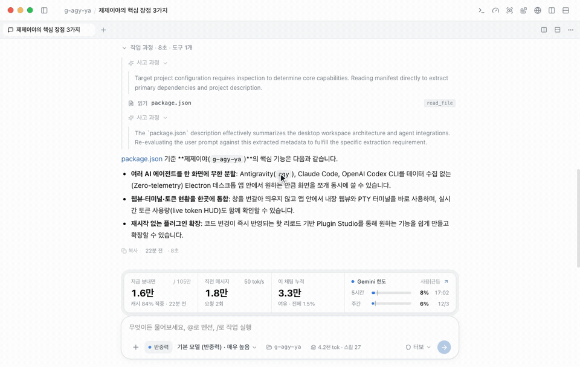

<div align="center">


# 제제이야 (`g-agy-ya`)

**순정 Antigravity(`agy`)에 토큰밴드 하나 달려는데 그것조차 못 만들게 막혀 있어서, 답답해서 직접 만든 AI 작업 앱.**

[한국어](README.md) · [English](README.en.md)

[](LICENSE)
[](#자주-묻는-것)

</div>

---

## 왜 만들었나요?

순정 Antigravity를 쓰다가 **"지금 토큰을 얼마나 쓰고 있지? 한도가 얼마나 남았지?"** 보고 싶어서 토큰밴드 하나만 붙이려고 했습니다.  
그런데 순정 앱은 그 간단한 바 하나조차 못 만들게 꽉 막혀 있었습니다.

답답해서 그냥 직접 만들었습니다. 어차피 새로 만드는 김에 **내가 원하는 기능은 전부 플러그인으로 마음대로 붙이고 떼고**, **다른 AI 모델도 앱 안 갈아타고 한 곳에서 쓰고**, **창도 원하는 대로 쪼개 쓸 수 있게** 만들었습니다.

<p align="center">
  
</p>

- 채팅 입력창 바로 위에서 **지금 쌓인 토큰, 캐시 적중률, 생성 속도(`tok/s`), 5시간·주간 한도**를 실시간으로 봅니다.
- 눌러서 펼치면 **어떤 도구가 토큰을 얼마나 먹었는지**, **최근 턴 기록**까지 바로 확인됩니다.
- **토큰 밴드 통합 보드(`⌘⇧U`)** 를 열면 반중력 · Claude Code · Codex 3사 구독 한도를 한 화면에서 비교할 수 있습니다.

---

## 핵심 기능

### 1. 플러그인 철학 — 모든 기능이 플러그인

토큰밴드 하나 못 달아서 답답했던 게 시작이었기 때문에, **아예 앱의 모든 기능을 독립 플러그인**으로 쪼갰습니다.  
채팅창도, 토큰밴드도, 내장 브라우저도, 터미널도 전부 플러그인입니다.

<p align="center">
  
</p>

- **UI X-Ray (`⌘⇧X`)**: 화면의 어느 영역이 어떤 플러그인으로 만들어져 있는지 바로 투시해서 봅니다.
- **통창 플러그인 스튜디오 (`⌘⇧P`)**: 필요한 기능만 재시작 없이 실시간으로 켜고 끕니다. (위 GIF처럼 토큰밴드 스위치를 끄면 채팅창에서 바로 사라지고, 켜면 바로 살아납니다.)
- **내 플러그인 직접 만들기**: 폴더 하나 만들어 마운트하면 코드를 고치는 즉시 앱 재시작 없이 바로 반영됩니다. ([샘플 플러그인 보기](examples/sample-focus-timer))

---

### 2. 다른 모델 한 앱에 — 반중력 · Claude · Codex

모델 바꿀 때마다 앱 껐다 켰다, 터미널 탭 찾아다닐 필요 없습니다.  
**내 컴퓨터에 이미 깔린 공식 CLI(`agy`, `claude`, `codex`)를 한 앱에 모아** 그대로 씁니다.

<p align="center">
  
</p>

- 버튼 한 번으로 **반중력(Antigravity) ↔ Claude Code ↔ OpenAI Codex**를 바로 갈아탑니다.
- Gemini 4 · Claude · GPT 등 **27개 이상의 모델과 추론 강도(낮음~매우 높음)** 를 바로 골라 쓸 수 있습니다.
- 아예 **반중력 · Claude · Codex를 한 화면에 3열로 나란히 띄워놓고** 동시에 시키고 비교할 수도 있습니다.
- 별도 API 키 등록 없이, 기존 공식 CLI 로그인과 내 로컬 스킬·규칙·MCP 설정을 그대로 이어받습니다.

---

### 3. 창 분리 기능 — 채팅 · 브라우저 · 터미널을 한 화면에

AI 창 따로, 브라우저 따로, 터미널 따로 띄워놓고 `⌘Tab` 누르며 왔다 갔다 하지 마세요.  
원하는 대로 화면을 끝없이 쪼개고 붙일 수 있습니다.

<p align="center">
  
</p>

- **좌우(`⌘D`) · 상하(`⌘⇧D`) 무한 분할**: 필요한 만큼 창을 계속 나눕니다.
- **탭 드래그로 도킹**: 탭을 마우스로 끌어다 다른 창 가장자리에 놓으면 알아서 쪼개져 붙습니다.
- **내장 브라우저(`⌘T`) & 내장 터미널(`⌘⇧T`)**: 채팅 바로 옆에 `localhost` 미리보기, GitHub, 문서, 터미널을 같이 띄워두고 작업합니다.

---

## 설치 및 실행

### 필요한 것

- **Node.js 22+**
- 아래 공식 CLI 중 **쓰고 싶은 것 하나 이상** (전부 깔 필요는 없습니다)
  - **Antigravity (`agy`)**: 설치 후 로그인 (앱 안에서도 원클릭 로그인 가능)
  - **Claude Code (`claude`)**: `npm install -g @anthropic-ai/claude-code`
  - **OpenAI Codex (`codex`)**: `npm install -g @openai/codex`

### 실행 (3줄)

```bash
git clone https://github.com/moneycode11101-svg/g-agy-ya.git
cd g-agy-ya
npm install && npm start
```

> 개발 모드로 수정하면서 띄우려면 `npm run dev`를 쓰면 됩니다.

---

## 자주 쓰는 단축키

| 단축키 | 하는 일 |
| :--- | :--- |
| `⌘N` | 새 채팅 열기 |
| `⌘D` / `⌘⇧D` | 오른쪽 / 아래로 창 분리 |
| `⌘T` | 옆에 내장 브라우저 열기 |
| `⌘⇧T` | 옆에 터미널 열기 |
| `⌘⇧U` | 3사 통합 토큰 밴드 보드 열기 |
| `⌘⇧P` | 플러그인 스튜디오 열기 (통창) |
| `⌘⇧X` | UI X-Ray 투시 켜기 / 끄기 |
| `⌘B` | 왼쪽 사이드바 열기 / 닫기 |

---

## 자주 묻는 것

- **내 대화나 키가 외부 서버로 가나요?**  
  아니요. 추적 코드·외부 중계 서버 **0%** 입니다. 내 컴퓨터에 깔린 공식 CLI를 로컬에서 직접 부를 뿐입니다.
- **CLI 로그인이 풀리면 터미널 켜야 하나요?**  
  아니요. 앱 안에서 버튼 한 번으로 바로 다시 로그인할 수 있습니다.
- **Mac 말고도 되나요?**  
  macOS 기준으로 만들었지만 Electron 앱이라 Windows/Linux에서도 실행할 수 있습니다. (내장 터미널은 `python3` 필요)

---

## 라이선스

[MIT License](LICENSE)
