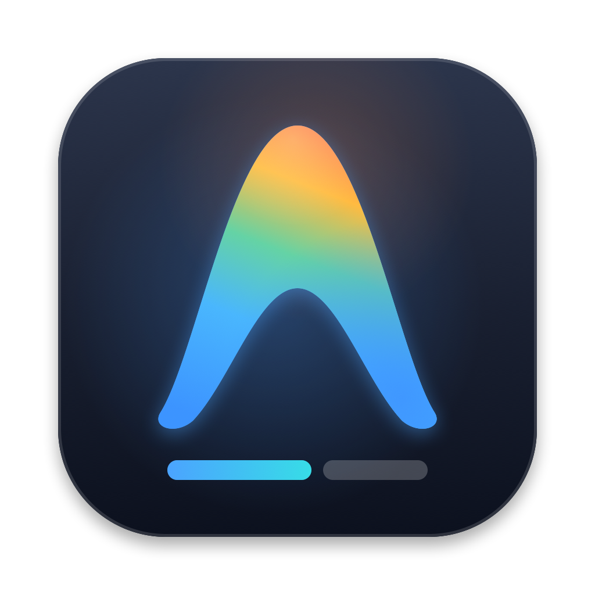
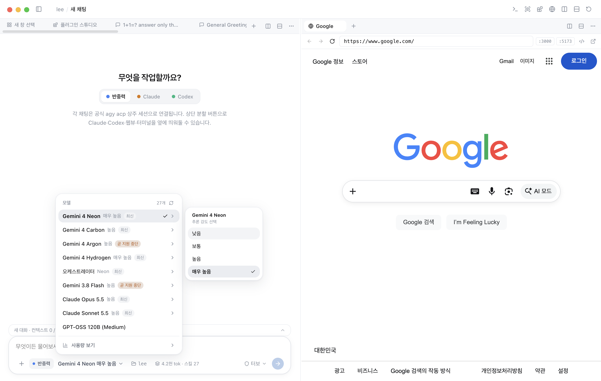
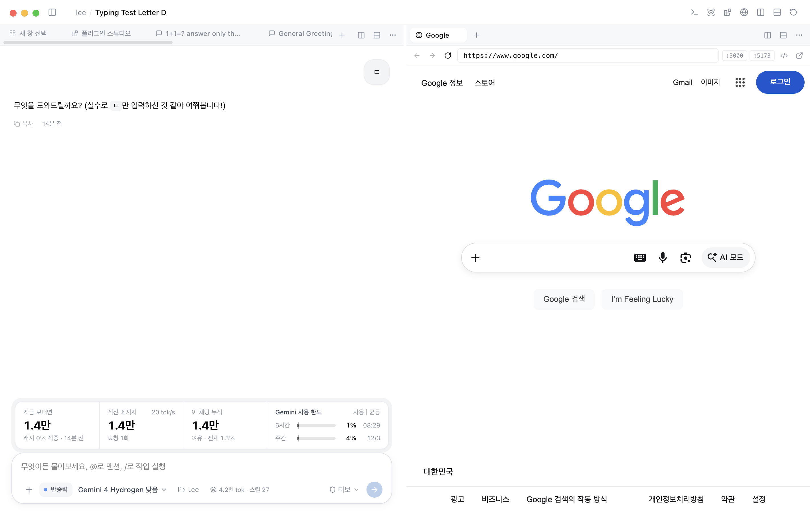
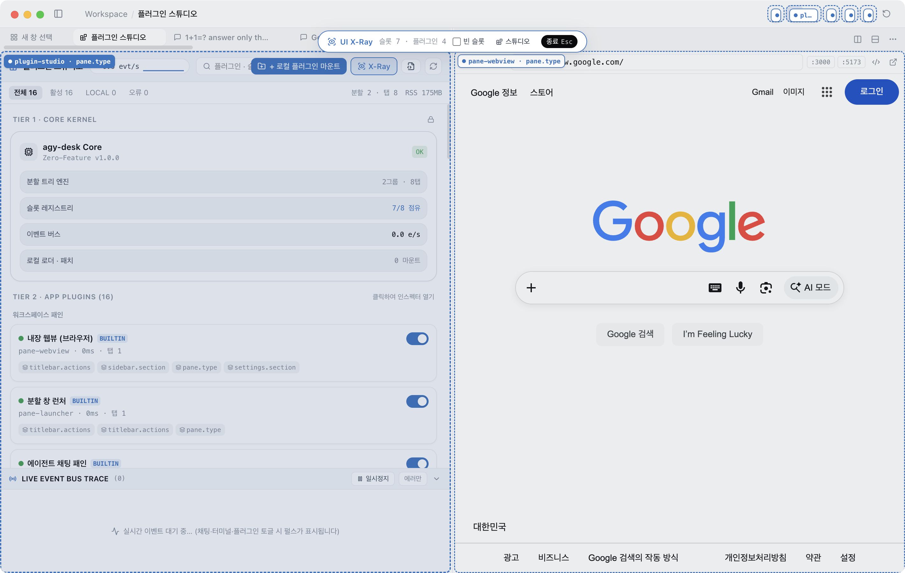
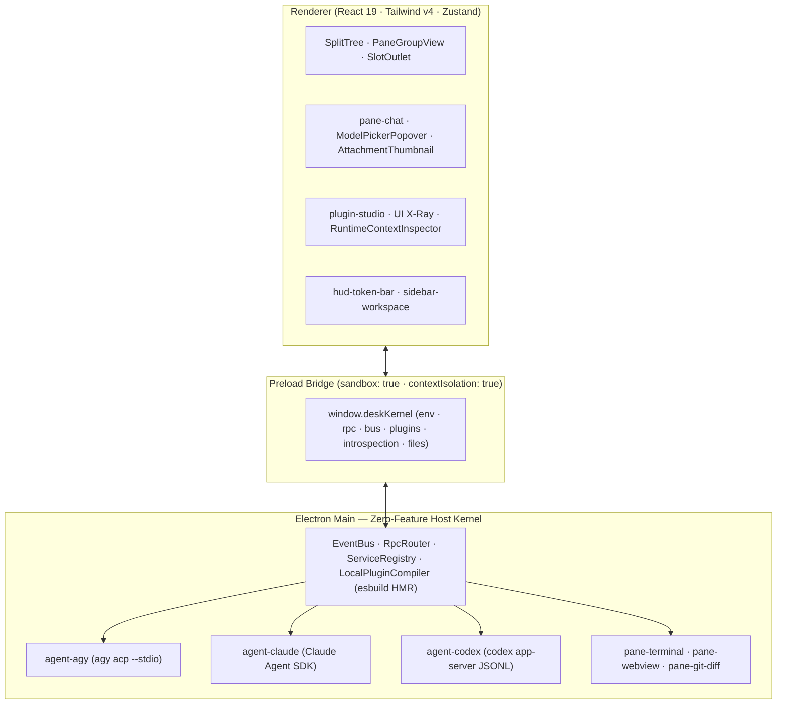

<div align="center">



# 제제이야 (`g-agy-ya`)

**Antigravity · Claude Code · OpenAI Codex를 하나의 무한 분할 워크스페이스에서.**  
로컬 공식 CLI 세션을 그대로 연결하는 초경량 · 텔레메트리 0% 멀티 에이전트 Electron 데스크톱 앱.

[한국어](README.md) · [English](README.en.md)

[](LICENSE)
[](https://www.electronjs.org/)
[](https://react.dev/)
[](https://www.typescriptlang.org/)
[](#프라이버시--로컬-우선-설계)

<br />



</div>

---

## 왜 제제이야(`g-agy-ya`)인가?

터미널 창 여러 개, 브라우저, AI 에이전트 앱 사이를 오갈 필요 없이 **내 PC에 설치된 공식 CLI(`agy`, `claude`, `codex`)를 한 화면에 모아 무한 분할**로 작업할 수 있습니다.

- **BYO CLI · 텔레메트리 0%**: 외부 중계 서버·분석 스크립트·별도 API 키 저장 없이, 본인 PC의 공식 CLI 로그인과 로컬 스킬·규칙·MCP 설정을 그대로 이어받습니다.
- **한 번의 클릭으로 CLI 재로그인**: CLI 세션이 만료돼도 앱 안에서 바로 공식 로그인(`agy acp` / `claude auth login` / `codex login`)을 완료하고 방금 실패한 메시지를 자동 재전송합니다.
- **제로 피처(Zero-Feature) 플러그인 커널**: 채팅, 터미널, 웹뷰, Git Diff, 토큰 HUD, 에이전트 어댑터까지 총 **16개 기능이 모두 독립 플러그인**으로 분리되어 실시간 On/Off·핫 리로드가 가능합니다.

---

## 핵심 기능

### 1. 3대 에이전트 공식 프로토콜 상주 세션

| 엔진 | 프로토콜 / 런타임 | 주요 지원 기능 |
| :--- | :--- | :--- |
| **Antigravity (`agy`)** | 공식 `agy acp --stdio` 상주 데몬 | 27+ 모델 계층형 피커(추론 강도 선택), 멀티모달 이미지 드롭, 사고 과정·도구·승인 카드 실시간 스트리밍, 메시지 대기열(`→` 즉시 전송 / 편집 / 삭제), 원클릭 ACP 로그인 |
| **Claude Code (`claude`)** | `@anthropic-ai/claude-agent-sdk` 상주 세션 | 로컬 `CLAUDE.md`·훅·스킬·MCP 자동 유지, 양방향 도구 승인 및 `AskUserQuestion` 카드, 5시간/주간 공식 할당량, 원클릭 `claude auth login` |
| **OpenAI Codex (`codex`)** | `codex app-server --stdio` JSONL 상주 세션 | 실행 중 턴 스티어링(steering), 양방향 승인·질문, 멀티 `CODEX_HOME` 프로필 전환, 5시간/주간 공식 한도, 원클릭 `codex login` |

- **이미지 드래그 앤 드롭 & 썸네일 스트립**: 파인더·스크린샷·클립보드(`⌘V`)에서 이미지를 끌어다 놓으면 입력창 상단에 썸네일로 쌓이고, 클릭 시 라이트박스로 확대 확인할 수 있습니다.
- **한글 IME 최적화**: macOS 2벌식 한글 조합 중 단일 `Enter` 전송, `@` 실시간 워크스페이스 파일 멘션, `/` 슬래시 명령어·스킬 자동완성을 지원합니다.

### 2. 무한 분할 워크스페이스 & 라이브 토큰 HUD



- **재귀 분할 트리 + 드래그 도킹**: 좌우(`⌘D`) · 상하(`⌘⇧D`) 무한 분할, 탭 드래그로 가장자리 분할/이동, 탭 색상·고정·이름 변경 지원.
- **내장 크로미움 웹뷰 (`⌘T`)**: 채팅 바로 옆에 `localhost:3000` / `:5173` 개발 서버나 문서를 띄우고 원클릭 DevTools 토글.
- **내장 PTY 터미널 (`⌘⇧T`) & Git Diff**: `xterm.js` 기반 터미널과 실시간 Git 변경사항 뷰어를 분할 패인으로 배치.
- **제로 오버헤드 토큰 · 할당량 HUD**: 프롬프트에 토큰을 1도 추가하지 않고 컨텍스트 점유율, 캐시 적중률, 생성 속도(`tok/s`), 누적 사용량, 5시간/주간 공식 한도를 실시간 표시합니다.

### 3. Plugin Studio & UI X-Ray



- **Plugin Studio (`⌘⇧P`)**: 코어 커널 상태, 16개 내장 플러그인의 실시간 토글·의존성·점유 슬롯, 그리고 라이브 이벤트 버스 트레이스를 한눈에 확인합니다.
- **UI X-Ray (`⌘⇧X`)**: 앱 화면 위 어느 영역이 어떤 플러그인·슬롯에 마운트되어 있는지 실시간 투시 오버레이로 확인합니다.
- **로컬 외부 플러그인 HMR 마운트**: 내 컴퓨터의 플러그인 폴더를 마운트하면 `esbuild` Compile-Before-Swap으로 앱 재시작 없이 핫 리로드됩니다([`examples/sample-focus-timer`](examples/sample-focus-timer) 참고).
- **런타임 컨텍스트 인스펙터**: 내 PC의 `~/.gemini/config/`, `~/.claude/`, `~/.codex/`에 설치된 스킬·룰·MCP·훅의 토큰 비용을 동적으로 스캔해 표시합니다.

---

## 빠른 시작

### 사전 요구사항

- **Node.js 22+** 및 **npm**
- **macOS** 권장 (Windows/Linux에서도 Electron 실행 가능, 터미널 패인은 `python3` 필요)
- 사용할 에이전트 CLI 중 **하나 이상** 설치 (모두 설치할 필요는 없습니다):
  - **Antigravity CLI (`agy`)**: 설치 후 `agy` 또는 앱 내 **CLI 로그인** 버튼으로 로그인
  - **Claude Code (`claude`)**: `npm install -g @anthropic-ai/claude-code` 후 `claude auth login` (또는 앱 내 로그인)
  - **OpenAI Codex (`codex`)**: `npm install -g @openai/codex` (또는 macOS ChatGPT/Codex 앱 내장 바이너리 자동 탐색) 후 `codex login`

### 설치 및 실행

```bash
git clone https://github.com/moneycode11101-svg/g-agy-ya.git
cd g-agy-ya
npm install

# 개발 모드 (Vite HMR + Electron)
npm run dev

# 프로덕션 빌드 후 실행
npm start
```

---

## 주요 단축키

| 단축키 | 동작 |
| :--- | :--- |
| `⌘N` | 새 채팅 탭 추가 |
| `⌘D` / `⌘⇧D` | 오른쪽 / 아래로 분할 |
| `⌘T` | 옆에 내장 웹뷰 분할 열기 |
| `⌘⇧T` | 옆에 PTY 터미널 분할 열기 |
| `⌘⇧P` | Plugin Studio 열기 |
| `⌘⇧X` | UI X-Ray 투시 오버레이 토글 |
| `⌘B` | 왼쪽 워크스페이스 사이드바 토글 |
| `⌘W` | 현재 탭 닫기 |
| `Enter` / `⌥Enter` | 메시지 전송(실행 중에는 대기열 추가) / 즉시 끼어들어 전송 |
| `⌃C` | 응답 생성 즉시 중지 |

---

## 아키텍처 개요



---

## 프라이버시 & 로컬 우선 설계

- **외부 텔레메트리 0%**: 앱 내부에 PostHog, Sentry, Axiom, 클라우드 중계 서버 등 어떠한 추적·전송 코드도 포함하지 않습니다.
- **개인 스킬·설정 완전 분리**: 이 저장소에는 어떤 개인 스킬·프롬프트·계정 정보도 포함되지 않습니다. 실행 시 사용자의 로컬 CLI 설정 폴더(`~/.gemini/config`, `~/.claude`, `~/.codex`)만 동적으로 읽어 표시합니다.
- **샌드박스 격리**: 렌더러와 내장 `<webview>`는 모두 `sandbox: true`, `contextIsolation: true`, `nodeIntegration: false`로 격리됩니다.

---

## 라이선스

[MIT License](LICENSE)
